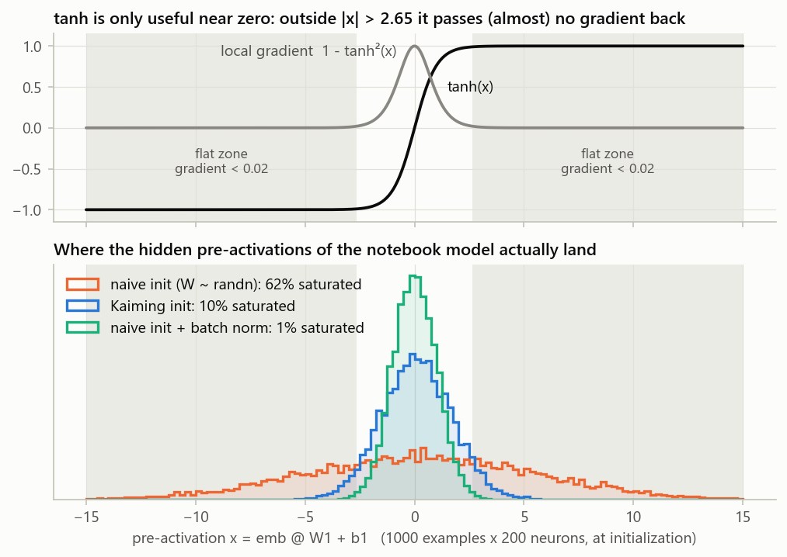
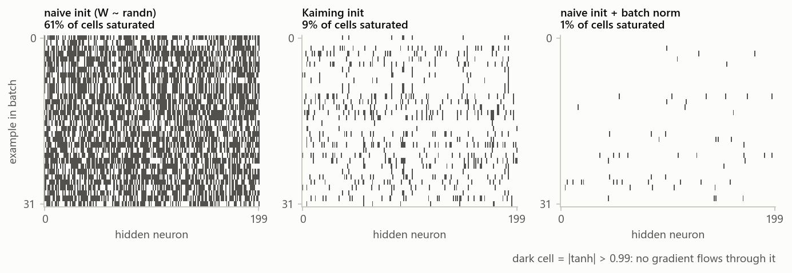
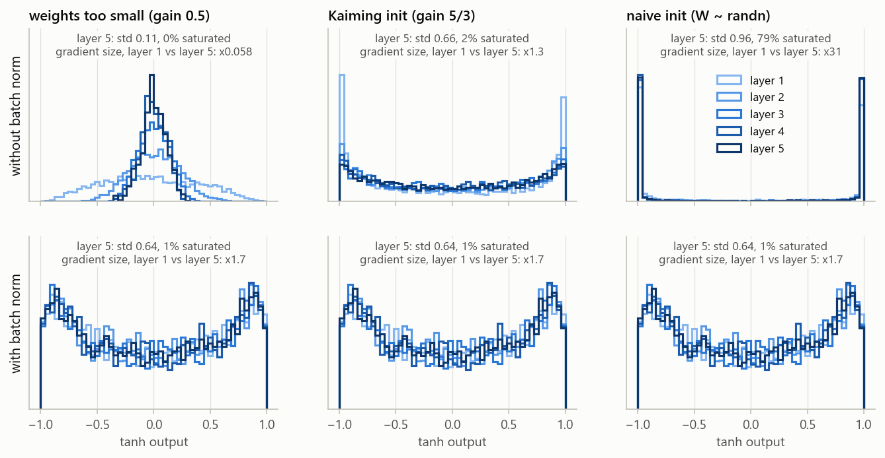
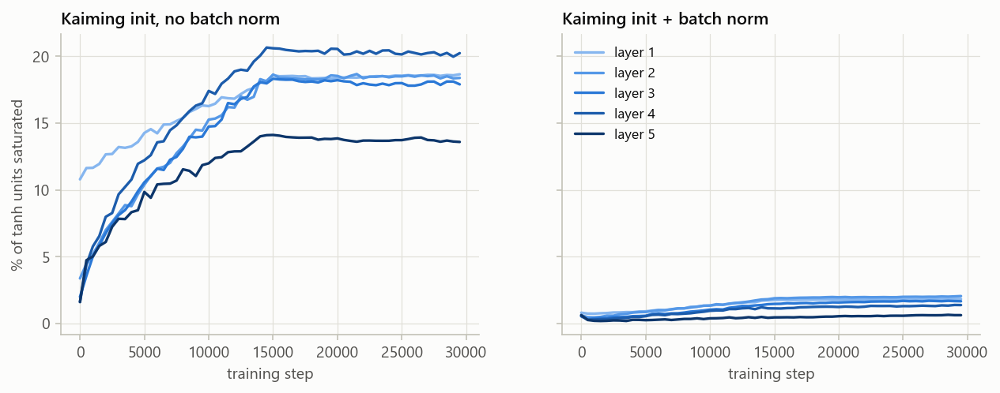
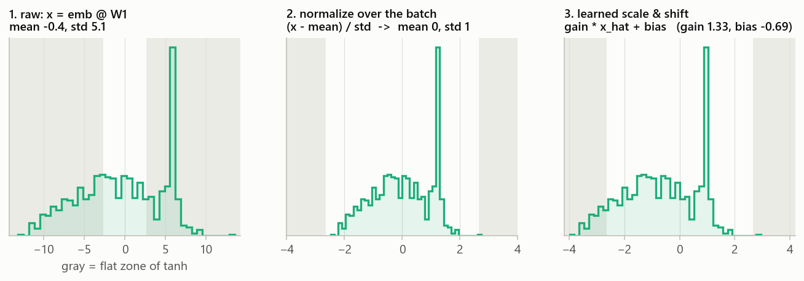
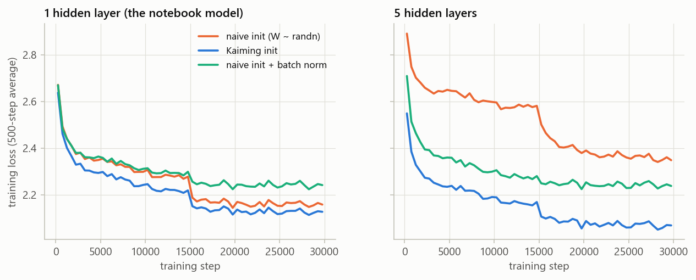

# Why batch normalization?

All figures come from real runs of the notebook model (`names.txt`, 3-char context, 10-dim embeddings, tanh MLP).
To regenerate them, run `python batchnorm_figures.py` (about 10 min on CPU).

**In one sentence:** tanh only learns when its inputs are near zero. Careful init can put them there, but that breaks
as the network gets deeper and as training changes the weights. Batch norm keeps them there automatically, in every layer, at every step.

---

## 1. The problem: tanh has flat zones



Backprop multiplies the incoming gradient by `1 - tanh(x)²`. For `|x| > 2.65` that factor is below 0.02, so the neuron
passes almost nothing back. With naive init (`W1 ~ randn`) the pre-activations have std ≈ 5.5, and **62 % of them land in a flat zone**.



Here is the same thing for one batch of 32 names. Each dark cell is an (example, neuron) pair that gets no gradient. A neuron that is dark
for every example in every batch never learns, which is what people call a *dead neuron*.

## 2. Fixing it with init works, but it is fragile

Scaling `W` by `gain / sqrt(fan_in)` (Kaiming init, gain 5/3 for tanh) gives the pre-activations the right width.
That is enough for one hidden layer. In a deep net, any error in the scale gets multiplied again at every layer:



- **Too small:** the signal shrinks layer by layer, and the gradient fades on its way back (layer 1 gets 0.06x the gradient of layer 5).
- **Too large:** almost every unit is stuck at ±1, and the gradient blows up on its way back (31x).
- **Exactly right:** this only works because 5/3 was worked out for tanh specifically, and only at step 0 (see below).
- **Bottom row, with batch norm:** all three columns are *identical*. Batch norm divides out the scale of `W`, so the init stops mattering for the forward pass.

**Init only controls step 0.** As training updates the weights, the distributions drift:



In the 5-layer Kaiming net, saturation climbs from 2–11 % to 14–20 % and stays there, because nothing pulls it back.
With batch norm it stays under 2 %. Every step re-centers every layer, so a unit only saturates if the network
*learns* to push it there through `bngain`/`bnbias`.

## 3. What batch norm does

For every neuron, over the current batch:

```python
hpreact = emb @ W1                                      # no b1: the mean subtraction would cancel it
hpreact = (hpreact - hpreact.mean(0)) / hpreact.std(0)  # force mean 0, std 1 -> inside tanh's useful range
hpreact = bngain * hpreact + bnbias                     # learnable: the net may widen/shift it if that helps
h = torch.tanh(hpreact)
```



This is one trained neuron. The raw input lives mostly in the flat zones (gray). After normalization it sits in the useful range, and the learned
gain and bias move it only as far as the network wants. (The tall spike comes from the many examples that share the context `...`, i.e. the start of a name.)

## 4. Does it pay off?



Dev loss after 30k steps (batch 32, lr 0.1 → 0.01). The batch-norm models are evaluated with mean/std calibrated on the full training set.

|                            | naive init | Kaiming init | naive + BN | Kaiming + BN |
|----------------------------|-----------:|-------------:|-----------:|-------------:|
| 1 hidden layer (200)       |      2.187 |    **2.147** |      2.217 |        2.172 |
| 5 hidden layers (100 each) |      2.359 |    **2.115** |      2.207 |        2.135 |

Here is what the numbers show:

- **Bad init hurts much more with depth.** The naive-vs-Kaiming gap is 0.04 with one layer and 0.24 with five.
- **Batch norm recovers most of that gap without touching the init** (2.359 → 2.207).
- **On a network this small, it does not beat a well-tuned init.** Batch norm makes the forward pass ignore the scale of `W`,
  but not the learning speed. With `W` 6x too large, each SGD step moves it 36x less relative to its size (measured).
  It also adds some batch noise. So use batch norm together with a sensible init (last column).
- **Where it really pays off** is in networks too deep to hand-tune every layer. That is why deep architectures (e.g. ResNets) put a
  normalization layer after almost every linear/conv layer.

## Things to remember

- **There is no batch at inference.** Use a mean/std computed over the training set (or the running averages `bnmean_running` / `bnstd_running`),
  not the stats of the single example you are sampling.
- **Examples in a batch now affect each other.** The batch stats add noise (a mild regularizer), and tiny batches make that noise large.
- **Paper:** Ioffe & Szegedy, 2015 (linked in the README).
